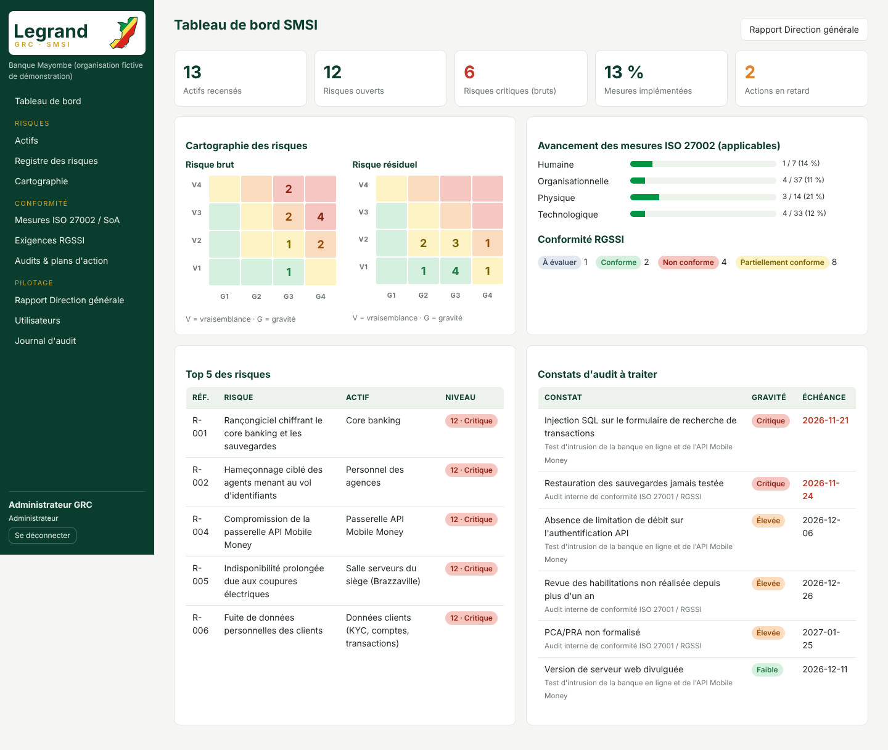
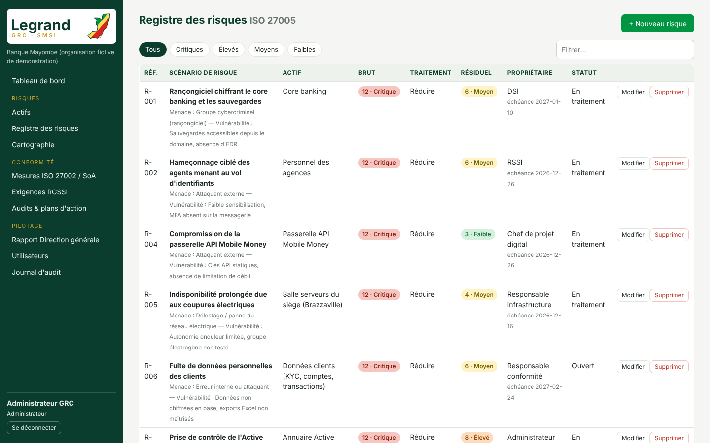
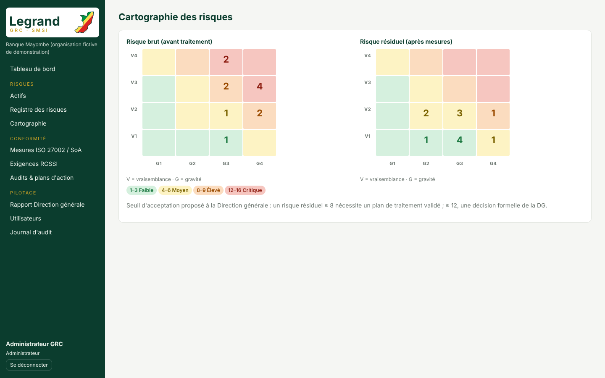
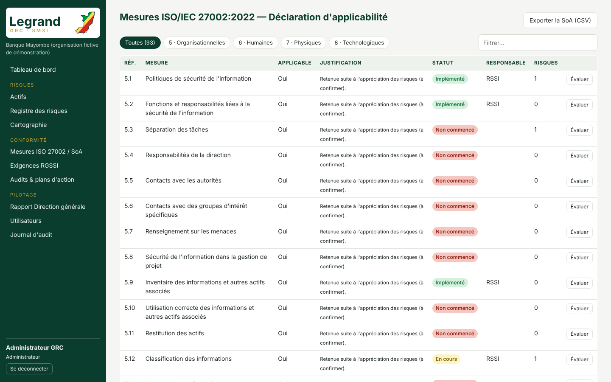
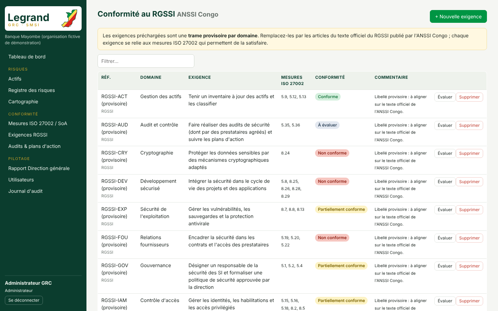
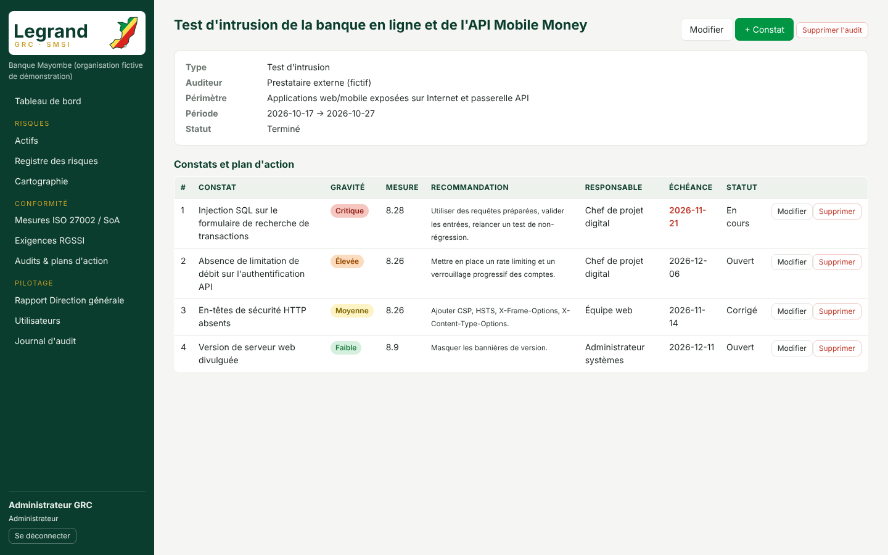
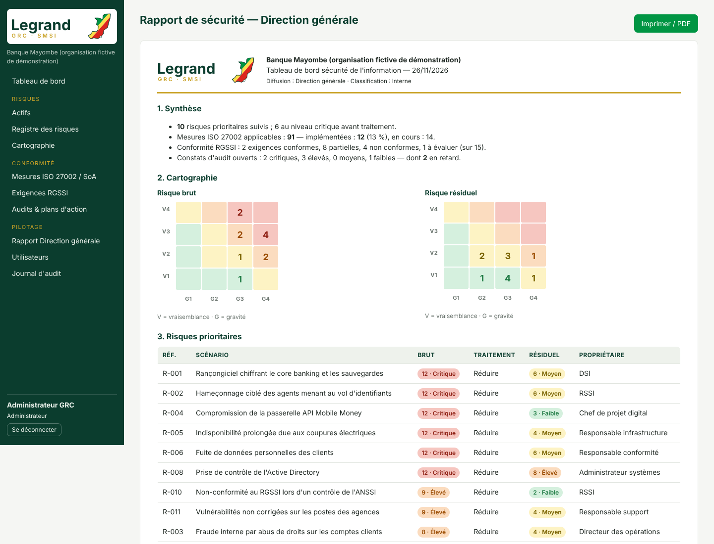

# Legrand GRC — Pilotage de la sécurité de l'information (ISO 27001 · ISO 27005 · RGSSI)

Plateforme web de **gouvernance, gestion des risques et conformité** pour un RSSI : registre des actifs et des risques, cartographie brute et résiduelle, déclaration d'applicabilité des **93 mesures de l'ISO/IEC 27002:2022**, suivi de la conformité au **RGSSI de l'ANSSI Congo**, audits de sécurité avec plans d'action, et rapport à la Direction générale.

Les données de démonstration décrivent une banque fictive de Brazzaville (core banking, passerelle Mobile Money, coupures électriques, prestataire d'infogérance…).



## Ce que le projet démontre

| Exigence d'un poste de RSSI | Où la trouver dans le projet |
|---|---|
| Analyse des risques ISO 27005 | Actifs (C/I/D), scénarios menace → vulnérabilité → conséquence, cotation V×G, traitement, risque résiduel, cartographie |
| Management de la sécurité ISO 27001 / 27002 | Déclaration d'applicabilité des 93 mesures (justification obligatoire, statut, preuves), export CSV |
| Conformité RGSSI (ANSSI Congo) | Exigences reliées aux mesures ISO 27002 et niveau de conformité par exigence |
| Suivi des audits de sécurité | Audits (interne, PASSI, test d'intrusion, contrôle ANSSI), constats, recommandations, échéances, retards |
| Reporting à la Direction générale | Rapport imprimable en PDF : synthèse, cartographies, risques prioritaires, actions en retard, décisions attendues |
| Sécurité dès la conception | L'application applique elle-même les mesures qu'elle pilote (voir ci-dessous) |
| Documentation du SMSI | `docs/` : PSSI, méthode d'analyse des risques, PCA/PRA |

## Sécurité de l'application (« on applique ce qu'on prône »)

| Mesure | Mise en œuvre | ISO 27002 |
|---|---|---|
| Injection SQL | PDO avec requêtes préparées partout, `ATTR_EMULATE_PREPARES=false` | 8.28 |
| XSS | Échappement systématique `htmlspecialchars` et CSP stricte (aucun script ni style en ligne) | 8.26, 8.28 |
| CSRF | Jeton par session vérifié sur tous les POST ; suppressions uniquement en POST | 8.26 |
| Authentification | `password_hash` (bcrypt), vérification à temps constant, politique de 12 caractères | 8.5, 5.17 |
| Force brute | Verrouillage après 5 échecs en 15 min (par compte et par IP) | 8.5 |
| Sessions | Cookie `HttpOnly`, `SameSite=Strict`, `Secure` en HTTPS, régénération à la connexion, expiration après 30 min d'inactivité | 8.5 |
| Contrôle d'accès | RBAC à 4 rôles : admin, RSSI, auditeur, lecteur (Direction) | 5.15, 5.18, 8.2 |
| Journalisation | Journal d'audit : connexions, échecs, verrouillages, accès refusés, créations, modifications, suppressions, exports | 8.15 |
| En-têtes HTTP | CSP, X-Frame-Options, nosniff, Referrer-Policy, Permissions-Policy, HSTS | 8.26 |
| Erreurs | Aucune trace technique affichée ; erreurs journalisées côté serveur | 8.28 |
| Export CSV | Neutralisation de l'injection de formules (`=`, `+`, `-`, `@`) | 8.28 |
| Secrets | Aucun secret dans le code (`config.php` et `.env` ignorés par git) ; mots de passe aléatoires à l'installation | 8.24 |
| CI/CD | Lint, tests, SAST Semgrep (OWASP Top 10), détection de secrets Gitleaks | 8.25, 8.29 |

## Installation

### Option A — démonstration rapide (PHP 8.1+ et SQLite, sans serveur MySQL)

```bash
cp config/config.example.php config/config.php
# dans config/config.php, activer la ligne 'db_dsn' => 'sqlite:...'
php database/install.php          # affiche les mots de passe générés
php -S 127.0.0.1:8080 -t public
```

### Option B — Docker (Apache et MySQL 8)

```bash
cp .env.example .env              # puis changer les mots de passe
docker compose up -d --build
docker compose exec app php database/install.php
# → http://localhost:8080
```

### Option C — XAMPP / WAMP

Créer la base `legrand_grc`, copier `config/config.example.php` en `config/config.php`, renseigner les identifiants MySQL, lancer `php database/install.php`, puis faire pointer le serveur web vers `public/`.

Comptes de démonstration créés : `admin@`, `rssi@`, `auditeur@` et `dg@legrand-grc.local`. Les mots de passe sont affichés une seule fois à l'installation. Options : `--no-demo` (base vide) et `--reset` (réinstallation).

## Tests

```bash
php tests/run.php     # 16 tests unitaires : cotation, validation des entrées, politique de mot de passe…
```

Vérifié aussi : rejet sans jeton CSRF (400), refus d'écriture pour le rôle lecteur (403), verrouillage après 5 échecs, échappement d'une charge `<script>`, rejet des dates et des identifiants invalides.

## Architecture

```
public/            point d'entrée unique (index.php), CSS, JS, logo
src/
  bootstrap.php    configuration
  db.php           accès PDO
  security.php     en-têtes, session, CSRF, journal
  auth.php         authentification, RBAC, verrouillage
  risk.php         cotation et cartographie
  controllers.php  logique des pages
  views/           gabarits
database/          schéma (MySQL/SQLite), 93 mesures ISO 27002, données de démonstration, installateur
docs/              PSSI, méthode d'analyse des risques, PCA/PRA, captures
tests/             tests unitaires
```

## Note sur le RGSSI

Les exigences RGSSI préchargées sont une **trame provisoire par domaine** (gouvernance, risques, accès, cryptographie, journalisation, incidents, continuité…), signalée comme telle dans l'interface. Pour un usage réel, il faut les remplacer par les articles du texte officiel publié par l'ANSSI Congo. L'outil est conçu pour ça : chaque exigence se relie aux mesures ISO 27002 qui la couvrent et porte son propre niveau de conformité.

## Captures

| | |
|---|---|
|  |  |
|  |  |
|  |  |

---

**Auteur :** Elyse Flav-Legrand Mongouo — Ingénieur en Génie Numérique, certifié Google Cybersecurity · [Portfolio](https://mongouo-portfolio.mongouoflav.workers.dev/) · GitHub [Flav-legrand](https://github.com/Flav-legrand)
Projet complémentaire : [Legrand SOC](https://github.com/Flav-legrand/legrand-soc) — détection et réponse aux incidents.
